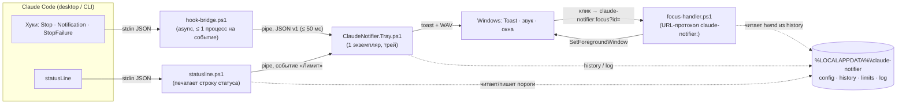
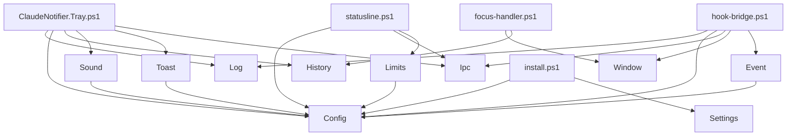

# 1. Context View

claude-notifier работает только локально на Windows 11. Claude Code (desktop и CLI) запускает его хуки и скрипт `statusLine`. Это короткие PowerShell-процессы: они нормализуют событие и передают его по named pipe долгоживущей **трей-программе**. Трей-программа показывает toast, играет звук и ведёт историю. Клик по toast вызывает зарегистрированный URL-протокол `claude-notifier:`, и его обработчик выводит окно сессии на передний план. Сети нет; внешних бинарных зависимостей нет (ADR-001).

**Факты среды, проверенные на целевом ПК 2026-11-16:** Smart App Control = **On** (`VerifiedAndReputablePolicyState=1`). PowerShell 5.1 работает в FullLanguage; `Add-Type` (C#), WinForms `NotifyIcon`, WinRT `ToastNotificationManager`, `NamedPipeServerStream`, `HttpListener` на 127.0.0.1 и `SoundPlayer` работают без прав администратора. Старт `powershell.exe -NoProfile` занимает ≈ 130 мс. Подписанный `python.exe` 3.12 стартует за ≈ 50 мс, но в стек не входит (ADR-001). Хуки получают переменные среды `CLAUDE_CODE_ENTRYPOINT` (`claude-desktop` или CLI) и `CLAUDE_CODE_HOST_SESSION_ID`.

# 2. Logical View  _(Context & Container Diagrams)_



| Контейнер | Эпик | Отвечает за |
|---|---|---|
| `hook-bridge.ps1` | e_001, e_003 | Разбирает вход хука; определяет origin и окно; отправляет событие; при необходимости запускает трей |
| `statusline.ps1` | e_004 | Выводит строку статуса; следит за порогами 80/90 % |
| `ClaudeNotifier.Tray.ps1` | e_002, e_005 | Мьютекс одного экземпляра, сервер pipe, toast, звук, меню, история |
| `focus-handler.ps1` | e_003 | Обрабатывает клик по toast или пункту истории |
| `install.ps1` / `uninstall.ps1` | e_001, e_005 | Копирует файлы, правит `settings.json`, регистрирует AUMID и URL-протокол |

# 3. Module / Component View



Граф ацикличен: модули из `lib/` не импортируют точки входа и друг друга, кроме `Config`. `cycles = 0`.

```text
claude-notifier/
├─ src/
│  ├─ ClaudeNotifier.Tray.ps1   # точка входа трея
│  ├─ hook-bridge.ps1           # аргумент: stop | notification | stopfailure
│  ├─ statusline.ps1
│  ├─ focus-handler.ps1         # аргумент: URI протокола
│  ├─ lib/
│  │  ├─ Config.psm1    # загрузка и валидация config.json, значения по умолчанию
│  │  ├─ Event.psm1     # вход хука → событие v1, превью ≤ 200 символов
│  │  ├─ Ipc.psm1       # клиент и сервер pipe, кадр = 1 строка JSON
│  │  ├─ Window.psm1    # Win32 P/Invoke через Add-Type: поиск и фокус окна
│  │  ├─ Toast.psm1     # WinRT toast XML, AUMID
│  │  ├─ Sound.psm1     # SoundPlayer, fallback на системный звук
│  │  ├─ History.psm1   # кольцевой буфер ≤ 100 событий, атомарная запись
│  │  ├─ Limits.psm1    # пороги и дедупликация по resets_at
│  │  ├─ Settings.psm1  # слияние и удаление записей в ~/.claude/settings.json
│  │  └─ Log.psm1       # лог с ротацией ≤ 1 МБ
│  └─ assets/icon.ico
├─ install.ps1 · uninstall.ps1 · config.default.json · README.md
└─ tests/  # Pester (*.Tests.ps1)
```

**Правила кода:** все `.ps1`/`.psm1` хранятся в **UTF-8 с BOM**. PowerShell 5.1 читает UTF-8 без BOM как ANSI, и кириллица ломает парсер (проверено). Совместимость только с Windows PowerShell 5.1: без `??`, `?.` и тернарного оператора. Установщик копирует `src/` в `%LOCALAPPDATA%\claude-notifier\app\`, поэтому пути в `settings.json` не зависят от расположения репозитория.

# 4. Data / API View

| Service | Endpoint | Method | Request | Response | Auth |
|---|---|---|---|---|---|
| Хук → bridge | stdin | exec | JSON хука (`session_id`, `cwd`, `last_assistant_message` / `message`, `notification_type` / `error`, `error_details`) | exit 0, без stdout | — |
| bridge/statusline → Tray | `\\.\pipe\claude-notifier-<USERNAME>` | 1 строка JSON | **Событие v1** (ниже) | — | DACL pipe: только текущий пользователь |
| statusLine | stdin/stdout | exec | JSON statusLine (`model.display_name`, `context_window.used_percentage`, `rate_limits.*`) | 1 строка текста | — |
| Toast → focus | `claude-notifier:focus?id=<event_id>` | URL-протокол | id события | — | id ищется только в локальной истории |

**Событие v1** (схема версионируется полем `v`; несовместимое изменение повышает `v`, A-2):

```json
{ "v": 1, "id": "uuid", "ts": "2026-11-16T12:00:00Z",
  "type": "done|permission|error|limit",
  "session_id": "…", "host_session_id": "local_…|null",
  "origin": "desktop|cli", "project": "claude-notifier",
  "title": "Готово · claude-notifier", "preview": "≤ 200 символов",
  "window": { "hwnd": 123456, "pid": 13028 } }
```

**Хуки, которые записывает установщик** (exec-форма через `args`, без shell; `async: true`):

| Событие Claude Code | matcher | Аргумент bridge → type |
|---|---|---|
| `Stop` | — | `stop` → `done` |
| `Notification` | `permission_prompt\|elicitation_dialog\|agent_needs_input` | `notification` → `permission` |
| `StopFailure` | — | `stopfailure` → `error` |

**Поиск окна (Window.psm1):** `origin` берётся из `CLAUDE_CODE_ENTRYPOINT` (`claude-desktop` → desktop, иначе cli). Для CLI окно ищется так: `GetConsoleWindow()` → `GetAncestor(GA_ROOTOWNER)`. Для Windows Terminal это даёт окно WT, для conhost — саму консоль. Для desktop и как fallback: обход родительских процессов до первого с видимым `MainWindowHandle`. Фокус: `ShowWindow(SW_RESTORE)` + `SetForegroundWindow`. Если окно уже закрыто (`IsWindow` = false), событие помечается `closed`.

# 5. Non-functional Requirements

Цели перенесены из PRD §5 без изменений.

| Aspect | Budget / Target | Как достигается |
|---|---|---|
| Событие → toast (P95) | ≤ 1 с | bridge: старт PS ≈ 130 мс + pipe ≤ 50 мс + toast; трей разбирает очередь каждые 100 мс |
| Хук-мост | ≤ 500 мс, всегда exit 0 | `async: true` — Claude Code не ждёт bridge; внутри всё обёрнуто в try/catch → exit 0; таймаут подключения к pipe 50 мс |
| Падение трея | Не влияет на Claude Code | Нет pipe → bridge запускает трей (FR-6), повторяет отправку 3 раза по 300 мс, затем пишет в лог и выходит с 0 |
| Безопасность | Только локально; без сети; без секретов в логе | Pipe с DACL текущего пользователя; превью не пишется в лог; переменные `*TOKEN*` и `*KEY*` не читаются |
| Совместимость | Smart App Control On | Только подписанные Microsoft `powershell.exe`, `conhost.exe` и .NET Framework (ADR-001) |
| Ресурсы | ≤ 150 МБ RAM, ≈ 0 % CPU в простое | Один процесс трея; таймер 100 мс без опроса диска; сервер pipe блокируется в фоновом runspace; в простое — EmptyWorkingSet через 30 с и каждые 5 мин |
| Наблюдаемость | Лог ≤ 1 МБ с ротацией; история ≤ 100 | `Log.psm1`, `History.psm1` |
| Доступность | Тип события передаётся текстом и звуком | Заголовок toast + свой звук для каждого типа |

# 6. Cross-cutting Concerns

- **Security:** входящий JSON хука проверяется по полям и типам, неизвестные поля отбрасываются (S-1). Превью попадает в toast XML только после XML-экранирования (S-5). Установщик делает резервную копию `settings.json` (`settings.json.bak-<ts>`) перед изменением. Свои записи он помечает путём к `%LOCALAPPDATA%\claude-notifier\app\` и удаляет только их. Без прав администратора; пишутся только HKCU (`Software\Classes\claude-notifier`, `Software\Classes\AppUserModelId\ClaudeNotifier`).
- **Logging & observability:** `%LOCALAPPDATA%\claude-notifier\log.txt`, уровни INFO/WARN/ERROR, ротация в `log.1.txt`.
- **Configuration / feature flags:** `config.json` — включение типов событий, путь к WAV для каждого типа, пороги лимитов `[80, 90]`, длина превью `200`. Неверные значения заменяются значениями по умолчанию с WARN в логе.
- **I18n & Accessibility:** строки интерфейса на русском лежат в одном словаре в `Config.psm1`; файлы в UTF-8 с BOM. Тип события дублируется текстом и звуком.
- **Licensing (A-7):** сторонних компонентов нет; используются только компоненты Windows.

# 6a. Трассировка PRD → архитектура (L-1)

| FR | Где реализуется |
|---|---|
| FR-1 | `install.ps1`/`uninstall.ps1` + `Settings.psm1` (§6 Security) |
| FR-2…FR-4 | Таблица хуков (§4) → `Event.psm1` |
| FR-5, FR-6 | `async: true`, try/catch → exit 0, автозапуск трея (§5) |
| FR-7 | `title`/`preview` события v1 → `Toast.psm1` |
| FR-8, FR-9 | `Sound.psm1` + `config.json` (§6 Configuration) |
| FR-10 | `Tray` показывает каждое событие без проверки активного окна |
| FR-11 | `Window.psm1` + `focus-handler.ps1` (§4, ADR-004) |
| FR-12…FR-14 | `statusline.ps1` + `Limits.psm1` (ADR-005) |
| FR-15, FR-16 | Меню `NotifyIcon` в `ClaudeNotifier.Tray.ps1`; пункт истории вызывает `focus-handler.ps1` |
| FR-17 | `README.md` |

# 7. Decision Log

| ADR | Решение |
|---|---|
| [001](adr/2026-11-16-001-stack-windows-powershell.md) | Стек: Windows PowerShell 5.1 + .NET Framework, без сторонних бинарников |
| [002](adr/2026-11-16-002-event-capture-async-command-hooks.md) | События: async command-хуки + bridge (а не HTTP-хуки) |
| [003](adr/2026-11-16-003-ipc-named-pipe.md) | IPC: named pipe + очередь в фоновом runspace |
| [004](adr/2026-11-16-004-toast-click-protocol-activation.md) | ~~Клик по toast: свой AUMID + URL-протокол~~ — заменено ADR-006 |
| [006](adr/2026-11-16-006-toast-click-not-supported.md) | Клик по toast не обрабатывается (нет exe-активатора); переход к сессии — «История» в трее; toast от AUMID PowerShell |
| [005](adr/2026-11-16-005-limits-via-statusline.md) | Лимиты: из `statusLine`, с запасными сигналами из хуков |

# 8. Risks & Open Items

| # | Риск | Проверка / fallback |
|---|---|---|
| R-1 | `statusLine` может не работать в desktop-приложении (PRD OQ-2) — **подтверждено 2026-11-16: не показывается** | Проверить в QA. Fallback: `StopFailure` с `rate_limit` и `Notification` с `quota_auto_resume_*` |
| R-2 | `SetForegroundWindow` из фонового процесса могут заблокировать — **проверено 2026-11-16: из «Истории» окно выходит вперёд**; клик по toast не доставляется вовсе (ADR-006) | Обработчик протокола запускается кликом пользователя и получает право на передний план. Если не сработает — мигание кнопки на панели задач (`FlashWindowEx`) |
| R-3 | При запуске трея из bridge может мелькнуть окно | Запуск через `conhost.exe --headless powershell.exe …` |
| R-4 | Конкретный чат в desktop открыть нельзя (deep-link не документирован) | Сохраняется `host_session_id`, чтобы добавить переход позже без смены схемы события |
